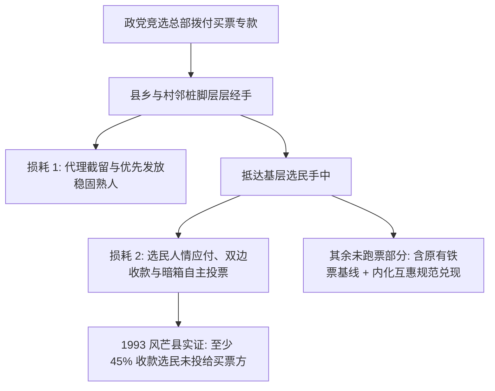

---

## 引言：寒冬里的一桶煤，与被误解的选票交易

如果明天的温饱尚无着落，民主选举中的那张选票，对一个人究竟意味着什么？

不妨把视线拉回 1880 年代纽约的一个冬夜。大雪席卷曼哈顿下东区，一户刚从爱尔兰抵美的劳工家庭挤在漏风的贫民窟公寓里：壁炉煤炭已尽，面包盒空空如也，做码头搬运工的父亲因病失业，全家正滑向欠租被逐与冻饿交迫的边缘。

就在此时，敲门声响起。站在门外的是一位穿着体面大衣的绅士——他既非市政福利官员，也非教会义工，而是民主党基层组织“塔曼尼会”（Tammany Hall）派驻本街区的代表，也就是政治学意义上的政治经纪人。进屋后，他没有谈论关税法案或宪政原则，甚至只字未提即将举行的大选，只是让随从搬进一桶取暖煤炭和一只火鸡，随即抽出一张字条拍拍大儿子的肩膀：“下周一去市政环卫处报到，我替你安排了一份足以撑过这个冬天的差事。”临走时，他握住父亲颤抖的手，语气温和却分量十足地叮嘱：“下周二选举日，请支持我们的候选人。”

等到下周二走进投票站，这位父亲会把票投给谁几乎毫无悬念。从 19 世纪中叶到 20 世纪中叶的近百年里（尤以镀金时代至 20 世纪初为盛），纽约这台名为“塔曼尼会”的城市政治机器曾依靠一桶桶煤炭、一只只火鸡与一个个基层岗位，将市长、法官、警察局长乃至联邦议员的席位牢牢攥在手中。

每当今天新闻里出现发展中国家选举季“送大米、发肥皂、塞现金”，或地方派系垄断公职换选票时，公共讨论场最先涌现的几乎总是一边倒的道德愤慨。在大量评论里，这类现象会被迅速归咎于政客贪腐或选民素质低下，仿佛开展几轮道德启蒙或司法抓捕，选举就能立刻回到清明轨道。

可居高临下的道德批判，恰恰让我们错失了看清政治运转真实激励的窗口。解释交易发生的激励，当然不等于替腐败开脱；恰恰相反，只有先看懂这笔交易为何在现实中反复成立，我们才能真正理解制度如何走出死结。剥开情绪迷雾，这类现象正是政治科学长期解剖的一对核心机制：**庇护主义（Clientelism）**与**分赃制（Patronage）**。

用一个生活类比就能迅速划清界限：现代福利国家承诺的“纲领式政治”，好比按公开费率与统一条款自动赔付的标准社保或商业车险——只要符合法定条件，无论支持谁，理赔都会如期到账；而庇护主义更像一家只认熟人介绍、平日给小恩小惠、遇事私下摆平的“地下互助会”，好处立等可取，代价却是下次投票不听招呼时保护伞便可能随时撤走。分赃制则是在后台持续供血的发动机：胜选政党把公职与合同当作战利品分给支持者，再将收益转化为下一轮选举的动员资本。

换作身处漏风公寓的你我，当手里唯一能立刻换来炉火与工作便条的筹码就是那张选票时，道德训诫还剩多少分量？由此引出贯穿本文的核心追问：在竞争性选举甚至不记名秘密投票的体制中，以私利换选票的庇护机器为何仍能长期运转？它在暗箱中如何防备违约，又在何种制度与经济条件下走向退场，乃至披上现代分配政治的外衣？要回答这些问题，必须先掀开塔曼尼会的财务账本。

## 一、分赃帝国的财政闭环：塔曼尼会与国家建构序列

外界谈及塔曼尼会，很容易把它想象成街头帮派式的无序掠夺。但若从组织经济学与历史制度主义视角拆解，这台 19 世纪的都市机器其实更像一家现金流极为严密的政治集团公司。

一个耐人寻味的问题是：为何城市分赃机器在 19 世纪美国如此繁盛，却未以同等规模出现在同一时期的所有西方国家？政治学家马丁·谢夫特（Martin Shefter）在《政党与国家：美国历史经验》中给出的答案直指制度建设的先后顺序。在他看来，决定政党是否依赖分赃动员的关键，不在于某个群体的文化劣根性，而在于**大众选举动员**与**独立常任文官体系**在历史上谁先落地——简言之，就是“先放开投票，还是先锁好官僚系统”。在部分欧陆国家，专业化官僚系统先于大众普选成形，行政职位早早被规则锁进“制度保险柜”，后来崛起的政党无从染指人事权，只能被迫依靠意识形态纲领和严密的党员组织去说服选民。

19 世纪的美国恰好走上了相反路径。白人男性普选权早在 1820 至 1830 年代便已铺开，但政府却长期缺乏独立于党派的常任文官体系。随后数十年里，数以百万计语言不通、识字率有限且陌生于美国宪政规则的欧洲新移民，潮水般涌入纽约、芝加哥等工业港口城市。面对短时间内暴增且高度分散的新选民，政党若靠宏大政纲逐一说服，沟通与组织成本高到几乎不可承受。于是，把尚未上锁的国家公职与公共财政直接铸造成动员货币，便成了阻力最小的选择。

这套货币触达街巷的末梢，是被称为“街区代办（Ward Boss）”的基层经纪人。他们不像高居市政厅的官僚，而是就住在移民社区里的邻里熟人，日常充当“非正式市政府”的客服：房东驱逐移民时代办出面协调展期，青年被捕时代办赶去警局保释并联系律师，邻里遇急病或断炊时便及时送去救济。通过这种高频率、极度人身化的救急，代办在底层编织出厚重的人情债务网。

买煤炭、火鸡和保释担保的现金又从何而来？秘密藏在市政厅的公职“奖品袋”里。这好比企业把全部岗位和采购外包当成内部抽奖券发给亲信，再规定中奖员工每月必须回吐部分薪水充当公司经费。在文官制确立前，市长或党魁一旦胜选，便有权清洗市政系统的绝大多数雇员——上至邮政局长、警察局长，下至环卫工与消防员，成千上万个稳定岗位被当作战利品分发给忠诚支持者。拿了职位也并非高枕无忧：按机器纪律，雇员发薪时通常须将工资的 2% 到 5% 作为强制“政治评估款（Political Assessments）”上缴党部（个别机构或竞选吃紧时比例更高），拒缴即丢饭碗。这笔稳定回流的现金流，直接养活了整套街区代办网络。

*图 1：塔曼尼会“街区救济—选票—公职与合同—回扣反哺”五环节财政闭环示意。*

如果说评估款维持了日常运营，市政工程采购制造的则是暴利金库。纽约修路、供水与市政建设扩张之际，塔曼尼会将大宗合同定向发包给关联建筑商，再通过大幅虚报账单向党魁输送回扣。1860 年代“特威德老板”（Boss Tweed）主导修建纽约县法院大楼（后称 Tweed Courthouse）便是惊人标本：1858 年州议会最初批复预算“不超过 25 万美元”，可历经多年拖延与虚报后，大楼最终耗费纳税人约 1300 万美元，接近 1867 年美国以 720 万美元购入整个阿拉斯加地区费用的两倍。历史档案记载，关联承包商在圈子授意下将发票普遍虚报 5 倍、10 倍乃至百倍——仅《纽约时报》披露的账册中，“扫帚及杂物”一项即开价 4.1 万余美元，单支温度计更报至 7500 美元。

至此，塔曼尼会完成了“送炭换选票—独占公职与合同—评估款与回扣反哺党库—扩大救济规模”的五环节闭环。正如谢夫特所揭示的，分赃机器客观上用腐败抽取的公共财政，为被现代国家福利遗漏的都市劳工搭建了一张非正式安全网。

可就在这套闭环看似坚不可摧时，19 世纪末的改革者投下了一枚足以动摇其履约根基的装置：**不记名秘密投票**。此前美国政党自印彩色党票，选民捏着红票或蓝票投箱，守在一旁的经纪人一眼便知谁兑现了诺言。可当源于澳大利亚的统一不记名白色选票自 1888 年马萨诸塞州率先推行、1889 年获纽约州立法并在 1890 年代迅速普及全美，选民独自走进拉上布帘的暗箱，机器瞬间失去了监票之眼。按常理推演，收了煤炭再暗中反水应当立即成为常态——但现实却偏偏没有在秘投制普及的第二天崩盘。

## 二、暗箱中的脆弱博弈：秘密投票、桩脚监控与 45% 漏票悖论

暗箱拉上布帘后，买票机器靠什么盯住选民？这双看不见的眼睛，又真的盯得住吗？

政治学家苏珊·斯托克斯（Susan C. Stokes）等人在《经纪人、选民与庇护主义》中点破了关键：秘密投票固然护住了隔间内的划票动作，却隔不断隔间之外密不透风的社会关系。为穿透信息黑洞，政党搭建起“党魁—基层经纪人—选民”的三层委托—代理结构：拉美称这批扎根社区的中介为“Punteros”，东亚地方政治则称之为“桩脚”。

这套架构运转起来，极像品牌总部把线下促销返现券交给区域渠道商铺货拉新：总部既看不清顾客进店后的真实选择，也无法盯紧渠道商在每条街道的派发损耗，只能仰仗混迹街坊的中间人辨别谁靠谱、谁会拿钱跑单。因为桩脚就住在选民隔壁，即便看不见暗箱里的铅笔印，他们仍握着三重暗箱外监控术。

第一重是**日常社交信号追踪**：选民是否出席造势晚宴、家门口愿不愿张贴竞选海报、街头寒暄时神情热络还是闪躲，都会被记进忠诚度账本。第二重是**基层票箱数据倒推**：最基层的投开票所往往只容纳几百张选票，桩脚清楚自己在该片区发了多少份钱；一旦开票数显著低于预期投放量，片区整体违约便立刻现形——不过随着投票区规模扩大，这种统计倒推的精度会迅速下降。紧随其后的则是**集体惩罚威胁**：既然抓不出单个叛徒，经纪人便可警告整个社区，倘若得票率持续滑坡，修路拨款或垃圾清运将被整体削减，借此制造邻里连坐监督。

这套监控链听上去严丝合缝，长期以来也让外界误以为“撒钱即锁票”。直到一项罕见的实证研究撕开了神话。

台湾政治学者王金寿与社会学者查尔斯·库兹曼（Charles Kurzman）发表于《国际政治学评论》（*International Political Science Review*）的经典论文，以及王金寿在《台灣政治學刊》的系列研究，剖析了 1993 年台湾地区某县长选举（论文化名为“风芒县”）。研究者深入参与观察地方派系运作，还罕见地取得了国民党候选人竞选总部的内部机密买票账册，并将其与投开票所实际开票结果逐一核对。结果颇具戏剧性：即便买票机器挨家挨户送出现金，在秘密投票的遮蔽下，收下买票款的选民中仍有**至少 45% 最终并未投给买票候选人**——他们有的转投反对党，有的干脆弃权。

*图 2：“党魁—桩脚—选民”三层委托—代理损耗路径及 1993 年台湾风芒县田野发现示意。*

这高达四成半以上的“漏票率（Leakage Rate）”——也就是发出去的买票款最终没能兑现成对应选票的损耗比例——把渠道商式的**委托—代理困境**暴露无遗。在代理端，买票专款从县级总部经乡镇干部流向村邻桩脚，每层都面临“吃钱”截留的诱因：桩脚深知暗箱无法核查，往往一边上报“每户均已发放到位”，一边把大笔款项留进腰包，或干脆只发给原本就稳投己方的熟人以求稳妥。在选民端，许多人收钱时抱持“人情应付”心态——乡邻上门塞钱，当面拒收反倒暴露立场、伤了和气，于是干脆笑纳，甚至同时收下竞争双方款项，进暗箱后再按真实偏好划票。

既然 1993 年风芒县的估算显示至少 45% 的买票款打了水漂（当然，这一比例下限受当时转型期派系生态与竞争烈度制约，不能机械套用为所有选举的固定常数），政党为何还要屡屡斥巨资撒钱？王金寿的田野观察给出了极具穿透力的回答：很多时候，买票资金买的不是选民孤立的良心，而是地方派系网络的“组织活性”。桩脚平时替派系跑腿维系人情，需要通过经手买票预算来确认自己在派系中受器重的地位；若上头不拨钱，桩脚便可能怠工甚至倒戈。只要经费按惯例流转，哪怕中间存在截留，桩脚也会倾力动员宗亲邻里出门投票——买票经费实质上是维持机器运转的“组织润滑油”。

换个角度看，即便扣除那些本来就会支持己方的铁杆选民，并计入至少四成半的高额漏票损耗，在既无警方监视、单人叛变又难被小票箱彻底锁定的暗箱里，依然有相当比例的收款选民最终兑现了非正式默契。究竟是什么无形力量管住了他们的手指？

经济学家弗雷德里科·菲南（Frederico Finan）与劳拉·谢克特（Laura Schechter）2012 年发表于《计量经济学》（*Econometrica*）的研究补上了最后一块拼图。他们做了次罕见的跨期追踪：先在 2002 年于巴拉圭农村开展信任与赠礼交换行为实验（让受试者在真实金钱博弈中决定是否回报陌生伙伴的善意），测出每个人的内化“互惠倾向（Reciprocity）”；四年后在 2006 年地方选举回访同一批人，追踪谁收了政党礼物、最终又投给了谁。数据揭示了双重规律：政党经纪人并不盲目撒钱，而是靠日常观察精准瞄准高互惠倾向选民；而高互惠倾向者收礼后在秘投中回馈该政党的概率显著更高。当“拿人手短”的内化羞耻感与熟人社区的名誉约束合流时，即便没有监票镜头，隐性契约依然能完成相当比例的自我履约。

## 三、穷人的政治保险单：高贴现率理性与庇护的隐性代价

看清了经纪人盯梢、派系润滑与互惠心理，一个更尖锐的疑问仍悬在半空：选民为了眼前一桶煤或一笔有限现金就交出选票，岂不是放弃了用选票争取公立学校、全民医保与洁净供水的长远权利？在局外人眼里，这似乎是一桩捡了芝麻丢了西瓜的买卖。

只有走进低收入群体面对的生存约束，才会发现这并非短视，而是严酷环境下的避险精算。政治学家赫伯特·基切尔特（Herbert Kitschelt）与史蒂文·威尔金森（Steven Wilkinson）指出，选民权衡“短期私利”与“长期政策承诺”的尺度，取决于两个变量：**时间贴现率**（简单说，就是一个人眼下的一块钱比未来的承诺值钱多少）与政策承诺的可信度。

设想一位月底交不起房租、明天随时可能断炊的临时工，面前摆着两个选项：一是此刻立刻到手的 500 元日结现金；二是老板口头许诺“三年后公司上市必定给你高额分红”。任何处于生存警戒线边缘的人，理性上都一定会先揣走那 500 元。政治市场遵循着同样的算术。当法治薄弱、行政承诺屡屡落空时，政客许诺“十年内建成全省公立医院”在底层眼中的可信度近乎为零。相比之下，街区代表递来的取暖煤、急诊担保或工作便条却是确定救命的资源。对明天就可能跌破温饱线的家庭而言，时间贴现率极高，眼前的确定救济理性地压倒十年后飘渺的制度蓝图。

詹姆斯·斯科特（James C. Scott）早在 1972 年对东南亚农村庇护政治的研究中，便刻画过这种生存逻辑。在缺乏市场保险与国家救济的环境里，“庇护人”与“委托人”结成的是虽不对称却承担保护预期的互惠网络：弱势者追求的不是收益最大化，而是避免跌破生存底线；只要赞助人在荒年与病灾时能出面托底，委托人便以劳动与效忠回报——而一旦赞助人在危机关头关闭粮仓、拒绝保护，这套依附关系便失去其道义正当性。尽管斯科特的观察扎根于 20 世纪中叶的东南亚乡村，这种以人身依附对抗高风险的逻辑，在 19 世纪纽约贫民窟同样清晰成立。

理解了这张“非正式生存保险单”，许多转型社会反腐运动遭到底层抵制的悖论便迎刃而解。当清廉精英仅凭道德号召与司法抓捕扫荡买票网络，却未同步搭建可即时兑现的替代性公共救助网时，在穷人眼中，恰恰是改革派砸碎了他们唯一应急的地下安全网；而那个虽然腐败却随叫随到的派系大佬，反倒成了唯一靠谱的贴心人。必须强调的是，指出孤立抓捕会遭遇抵制，绝不是为了替派系大佬辩护，而是为了说明脱离替代性福利供给的反腐治理往往事倍功半。归根结底，庇护主义生命力的根源从来不是人性贪欲，而是**公共制度供给的绝对匮乏**。

不过，若分析就此停在共情穷人的避险理性，便会滑向另一重偏差——将分赃机器浪漫化为一种“次优福利体系”。对此，必须做出显性的**学术让步**：传统公共政策批判者对庇护主义的忧虑，在长期结构层面上完全站得住脚。艾伦·希肯（Allen Hicken）在《政治学年鉴》的综述与基切尔特等人的比较研究均证明，庇护网络即便替少数家庭挡过一时风雪，却迫使整个社会付出三重沉重代价。

第一是**跨期贫困锁定**。庇护交换偏爱可随时收回的私人物品，天然排斥提升公民长期独立议价能力的教育与普惠资产积累——选民一旦中产化、手里有了储蓄，经纪人便失去了控制杠杆。第二是**公共财政严重失血**。正如纽约县法院造价飙升至 1300 万美元所揭示的，派系润滑与回扣最终都从被虚报挤占的市政税基中抽出，少数人拿到了煤块，全城却承受着残破基建与低效公共服务。第三是**民主问责空心化**。选举一旦退化为逐户竞价的私人拍卖会，政党便不再因修不好医院或学校而受罚，公民也被拆散为竞逐恩惠的孤立客户，难以凝聚推动普惠公共品制度化的集体力量。

既不能靠孤立抓捕直接摧毁，又不能放任其锁死长期发展——历史上那些曾经分赃横行的国家，究竟靠什么跳出了这重死结？

## 四、退场的制度密码：多因耦合、新政曲折与《哈奇法案》

1881 年 7 月 2 日，华盛顿特区火车站响起枪声。刚刚就职几个月的美国总统詹姆斯·加菲尔德（James Garfield）中弹倒地，在感染与漫长救治折磨近 80 天后于同年 9 月辞世。凶手查尔斯·吉托（Charles Guiteau）既非敌国特工，也非激进无政府主义者，而是一名自认在选举中立过汗马功劳的共和党支持者；他在选后反复向白宫索求驻巴黎或维也纳领事馆公职遭拒，在极度幻灭中扣动了扳机。

这场惨案引爆了全美对分赃制的怒火。但若以为一部改革法令落地便终结了分赃时代，便会掉入“单一因果简化论”的陷阱。古典分赃机器的退场绝非瞬间奇迹，而是**文官中立化、非人格化社会保障以及经济增长抬高选票价格**三股力量历时半个多世纪耦合推进的结果。

最先在**供给端**落下第一道杠杆的是 **1883 年《彭德尔顿法案》（Pendleton Act）**，它专司锁死公职录用。这部联邦文官制度奠基法律确立了公开竞争考试录用与公务员政治中立原则，禁止向受保护雇员强征“政治评估款”，也禁止政党轮替后随意清洗职业官僚。但必须澄清一个误解：《彭德尔顿法案》初生效时，**仅覆盖了当时约 13.2 万名联邦雇员中的约 10%**，地方市政岗位暂不在约束之列。而且，联邦改革向纽约市这类地方市政厅的传导存在漫长的时间差：塔曼尼会凭借对市政雇员任命与工程合同的掌控，一直撑到了 20 世纪 30 年代；直到州与市级文官规范陆续跟进、1930 年代改革派市政力量兴起，叠加随后而来的联邦新政救济，才在地方层面彻底合围并抽干党机器手里的公职“奖品袋”与评估款金库。

真正从**需求端**抽空庇护土壤的，正是这股由罗斯福新政开启的**非人格化现代福利国家**力量。以 1935 年《社会安全法案》为核心建立的养老金、失业保险与联邦救济体系，首次由国家直接向困境家庭提供法定托底。决定性变化在于程序的**“非人格化”**：公民只要符合法定年龄或贫困标准，就能直接向政府窗口申领补助，既不用找街区代办写推荐条，也不必拿周二的选票作抵押。国家阳光下的公民权，自此开始大规模替换地下庇护交易。

然而，制度演进在这里同样走过弯路。大萧条期间，以公共事业振兴署（WPA）为代表的新政救济机构扩张极快，但初期数百万救济岗位并未纳入《彭德尔顿法案》保护范围。漏洞随即暴露：1938 年国会选举前后，肯塔基、宾夕法尼亚与新墨西哥等多州爆出地方机器利用 WPA 岗位与救济名额胁迫工人投票、强索捐款的政治化丑闻。这场反弹倒逼国会于 **1939 年 8 月签署生效《哈奇法案》（Hatch Act）**——由新墨西哥州参议员卡尔·哈奇推动，专责堵住公职动员后门。该法明令禁止联邦行政雇员（后来更扩展至受联邦资助的州和地方雇员）参与党派竞选管理或利用职务胁迫选举。这道迟到的补丁证明：哪怕是普惠救济体系，若未同步锁死公职与资源的党派动员通道，依然可能被地方机器重新捕获。

前两道杠杆卡断了岗位供给与救济刚需，最终锁死机器退路的则是**市场端**的第三道杠杆——二战前后经济增长与中产阶级的壮大。比较政治研究显示，当人均收入跨过温饱门槛、家庭拥有稳定职业与储蓄后，选民对一桶煤或小额现金的边际效用急剧萎缩，转而关切税负、教育公平、司法独立等普惠公共品。当收购一张选票的单价飙升至政党财务难以负担的水平，同时大众媒体大幅压低跨区政策宣讲成本，政党便在成本精算下告别高损耗的“零售买票”，转向依靠政纲竞争。不过，收入增长并非机械消灭庇护的自动开关：在部分中高收入民主政体的特定地方派系或行业补贴中，隐蔽的庇护交换仍可能局部残存；经济增长大幅压缩的，主要是粗放的现金与实物零售买票。

供给断水、需求脱敏与市场涨价三者共振，终于把 19 世纪式的都市分赃帝国送入历史。但一个现实疑云随之浮现：今天成熟民主里砸向摇摆选区的公路拨款、行业补贴与拉美贫困现金直发，究竟只是穿西装的变相分赃，还是另一套政治逻辑？

## 五、穿西装的分配政治：庇护与猪肉桶的边界及拉美 CCT 博弈

观察当代民主选举时，人们常会陷入一个困惑：既然国会议员为摇摆选区争取基建拨款、政府向低收入家庭发放现金补助，客观上都能帮执政者拉来选票，这与塔曼尼会当年的分赃买票究竟有何不同？

政治科学在此严守一道概念边界：**并非所有用财政资源赢得选票的行为，都叫作庇护主义**。苏珊·斯托克斯等人在《经纪人、选民与庇护主义》中提炼出两把核心标尺，将分配政治精确划分开来。第一把标尺是**公开规则性（Public Rules）**：分配标准是否写进公开透明、受行政与司法复核的法定条款，而非依赖党魁或经纪人私下点名？第二把标尺是**个人条件可剥夺性（Contingency）**：假如某户居民在暗箱里投了反对票，政党能否单独精准地切断他的福利？

| 分配标准是否公开透明 | 不附带条件剥夺（无法针对个人投票断供） | 附带群体或个人条件交换 |
| --- | --- | --- |
| **遵循公开法定规则** | **纲领式普惠福利**（如巴西 Bolsa Família、法定社保） | 极少数规则内政绩激励，不以个人秘密投票为前提 |
| **依赖自由裁量倾斜** | **猪肉桶政治 / 俱乐部物品**（如美国国会选区基建定向拨款） | **灰区：集体条件化**（整条街得票不达标停供）→ **极端：古典个人庇护主义** |

*表 1：基于 Stokes 等人（2013）分配政治分类框架的概念边界矩阵。*

沿着这两把标尺去量一量美国国会预算中常见的“猪肉桶政治（Pork-barrel Politics）”——比如立法者把定向拨款（Earmarks）塞进预算案，为自己的农业选区或摇摆州修建一条未必急需的高速公路——差异便立刻显现。这好比市政部门决定只为某条街道铺设路面并装上路灯：在整体财政分配上，它无疑带有地域偏袒与选票算计，属于非规则化的地理倾斜，政治经济学称之为“俱乐部物品（Club Goods）”。但它缺少“个人条件可剥夺性”：路灯一旦亮起，街上无论支持者还是反对者都能借光回家，政客绝无可能只关掉反对者门前那一盏灯。

当然，正如前文第二章提到的小票箱集体惩罚威胁，两者之间也存在一条值得警惕的灰色过渡带：当执政者以“若该小片区得票率不达标就取消整条街的修路或清运拨款”相威胁时，这种集体条件化（党派倾斜型俱乐部物品）虽仍带有群体层面的选票交换压力，但其对单个选民的强制精准度，已远逊于点名撤走工作或救济的古典个人庇护。

更具启发性的当代制度实验，发生在曾深陷传统庇护泥潭的发展中民主地区。近二十年来，拉美多国大规模推行“有条件现金转移支付（CCT）”项目——贫困家庭只要让子女入学并接种疫苗，即可按月领钱。最初不少学者担忧，在基层派系林立的土壤里，这笔巨款会不会沦为地方市长与“桩脚”买票的新提款机？

巴西著名的“家庭补助金（Bolsa Família）”项目给出了令人瞩目的实证回应。娜塔莎·杉山（Natasha Borges Sugiyama）与温迪·亨特（Wendy Hunter）发表于《比较政治学》（*Comparative Politics*）的田野调查，以及布莱恩·弗里德（Brian J. Fried）在《世界发展》（*World Development*）的跨市政计量检验共同表明，哪怕在传统买票盛行的巴西东北部贫困地区，Bolsa Família 仍展现出极强的抗操纵韧性。

其秘密在于三道技术官僚防火墙：首先，由联邦统筹核验全国统一社会登记数据库（CadÚnico），按客观贫困指标筛选资格，使地方政客难以私自增删名单；其次，按客观公式分配各市镇配额，弗里德的检验几乎未发现资金向执政联盟友好市长或核心票仓倾斜的政治偏袒；最后，补助金在资金拨付环节跳过地方市政厅与社区中介，直接由联邦储蓄银行（Caixa Econômica Federal）打入受助人专属借记卡——尽管地方部门仍协助前端信息录入，但联邦核验与客观公式已基本锁死了地方政客私自增删名单的裁量权。受助者普遍清楚资金源自国家法定制度而非地方老板的私恩，因而并不觉得欠了某位候选人的选票债。

耐人寻味的是，塞萨尔·祖科（Cesar Zucco）在《美国政治科学杂志》（*American Journal of Political Science*）对 2002 至 2010 年巴西大选的研究证明，Bolsa Família 确实显著提升了执政党在贫困选民中的得票率。但这恰好印证了“政绩赢得选票”与庇护主义的本质区别：选民投出的是**纲领式与回顾性政绩奖赏（Programmatic & Retrospective Voting）**——即用选票对过去几年的治理实绩做一次公开验收，干得好就续约，干不好就换人。哪怕受助者转投反对党，下个月借记卡里的联邦补助也不会被任何桩脚划走。

当然，比较分析必须为巴西方案保留国别限定语：其防线之所以奏效，高度依赖联邦统一电子登记能力与国有直达银行基建。在基层行政薄弱、数据仍由地方干事手工掌握的地区，现金补贴仍面临地方政客争夺“功劳归属（Credit Claiming）”甚至局部截留的风险。反庇护的制度防线，永远需要持续维护。

## 结语：不确定性中的安全感与制度供给

一百四十多年后的今天，纽约曼哈顿下东区昔日的漏风木屋早已融入受供暖法规与现代电网覆盖的都市街区。如今的纽约市政环卫工人拥有受法律与工会保护的薪酬与岗位，不再因市长换届遭到整批清洗；低收入家庭若遇寒冬失业，只需对照公开标准向政府窗口或电子系统申领补助，不必在投票日前夜等待街区代表递来救命煤炭与附带条件的便条。

回望这段从 19 世纪纽约贫民窟出发、途经 1993 年台湾地区地方选举田野与巴拉圭乡村实验、最终延伸至当代巴西联邦直发借记卡的跨时空旅程，庇护主义与分赃机器的轮廓已足够清晰：它从不是特定文化道德缺陷或政治愚昧的怪胎，而是一部关于“如何在制度不确定性中寻找基本安全感”的政治经济学史。

只要自主常任文官体系尚未立住、普惠公共品屡屡失信、底层家庭随时面临跌破温饱线的风险，政党与脆弱选民便会在各自的理性激励下拼装出私人依附网络。尽管这台地下机器伴随高达近半的漏票损耗，并以锁定贫困、掏空财政和瘫痪公共问责为沉重代价，但脱离替代安全网的孤立道德抓捕，往往只会反噬改革者。唯有通过文官中立切断党派钱袋、以非人格化福利承接底线焦虑、在经济增长中抬高买票成本，并用类似《哈奇法案》与联邦电子直发系统的防线持续堵住后门，古典分赃机器才会真正退场。

下一次，当新闻里再次出现偏远选区派发米面现金或围绕公职工程展开暗箱动员时，或许我们可以收起廉价的道德优越感，转而用两把结构标尺去观察：那里的非人格化国家行政能力是否已经立住？普通人在遭遇失业、疾病与寒冬时，是否已拥有不必向任何个人效忠即可兑现的生存保障？

毕竟，如果把今天的我们放回 1880 年代那个没有社保、风雪交加的曼哈顿冬夜，面对炉火熄灭的客厅与那张能养活全家的环卫差事便条，又有多少人能做出比那位爱尔兰父亲更“超脱”、更符合教科书期待的选择呢？

---

## 参考来源

1. Finan, F., & Schechter, L. (2012). Vote-Buying and Reciprocity. *Econometrica*, 80(2), 863–881.
2. Fried, B. J. (2012). Distributive Politics and Conditional Cash Transfers: The Case of Brazil's Bolsa Família. *World Development*, 40(5), 1042–1053.
3. Hicken, A. (2011). Clientelism. *Annual Review of Political Science*, 14, 289–310.
4. Kitschelt, H., & Wilkinson, S. I. (Eds.). (2007). *Patrons, Clients, and Policies: Patterns of Democratic Accountability and Political Competition*. Cambridge University Press.
5. Scott, J. C. (1972). Patron-Client Politics and Political Change in Southeast Asia. *American Political Science Review*, 66(1), 91–113.
6. Shefter, M. (1994). *Political Parties and the State: The American Historical Experience*. Princeton University Press.
7. Stokes, S. C., Dunning, T., Nazareno, M., & Brusco, V. (2013). *Brokers, Voters, and Clientelism: The Puzzle of Distributive Politics*. Cambridge University Press.
8. Sugiyama, N. B., & Hunter, W. (2013). Whither Clientelism? Good Governance and Brazil's Bolsa Família Program. *Comparative Politics*, 46(1), 43–62.
9. Wang, C.-S., & Kurzman, C. (2007). Dilemmas of Electoral Clientelism: Taiwan, 1993. *International Political Science Review*, 28(2), 225–245.
10. Zucco, C. (2013). When Payouts Pay Off: Conditional Cash Transfers and Voting Behavior in Brazil 2002–10. *American Journal of Political Science*, 57(4), 810–822.
11. 王金壽 (1997). 〈國民黨候選人買票機器的建立與運作：一九九三年風芒縣長選舉的個案研究〉. 《台灣政治學刊》, (2), 3–62；及 (2004) 〈重返風芒縣〉, 《台灣政治學刊》, 8(2), 127–183.
12. Historical Society of the New York Courts / NYC.gov. *Tweed Courthouse & 19th-Century Political Assessments*.
13. U.S. National Archives. *Pendleton Civil Service Reform Act (1883)*.
14. U.S. Office of Special Counsel & U.S. Senate Historical Office. *The Hatch Act of 1939 and 1938 WPA Controversies*.
